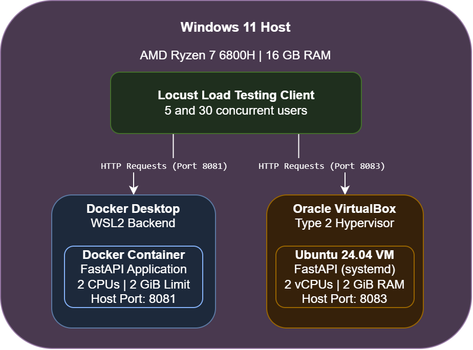

# Docker Containers vs Virtual Machines

**SEN421 – Cloud Architecture and Services**  
Fall 2026 – Topic 2, Part A

## Project Overview

This project compares Docker containers and VirtualBox virtual machines using the same FastAPI application under controlled workloads. The comparison covers response time, throughput, CPU usage, memory usage, startup time, storage footprint, and cost.

## System Architecture



- Docker Desktop with the WSL2 backend.
- Ubuntu 24.04 running on Oracle VirtualBox 7.2.20.

## Experimental Environment

| Component | Specification |
| --- | --- |
| Host OS | Windows 11 |
| Processor | AMD Ryzen 7 6800H |
| Host RAM | 16 GB |
| Storage | NVMe SSD |
| CPU allocation | Docker: 2 CPU quota; VM: 2 vCPUs |
| Memory allocation | 2 GiB per environment |
| Application | FastAPI 0.143.0 |
| Load testing tool | Locust |
| Docker host port | 8081 |
| VM host port | 8083 |

## Application Endpoints

| Endpoint | Description |
| --- | --- |
| `/health` | Returns application health status. |
| `/items` | Returns a predefined list of items. |
| `/compute` | Performs a calculation with 100,000 iterations. |

## Project Structure

```text
app/                   FastAPI application
docker/                Dockerfile
vm/                    systemd service configuration
tests/                 Load testing and monitoring scripts
analysis/              Python analysis and Jupyter Notebook
docs/                  Architecture and environment documentation
results/
  experiments/         Raw performance measurements
  resources/           CPU and memory measurements
  summaries/           Aggregated results
  figures/             Comparison charts
  preliminary/         Preliminary observations
requirements.txt       Application dependencies
requirements-lock.txt  Recorded application dependency versions
```

## Benchmark Configuration

| Parameter | Low Load | High Load |
| --- | --- | --- |
| Concurrent users | 5 | 30 |
| Spawn rate | 1 user/s | 5 users/s |
| Duration | 60 seconds | 60 seconds |
| Repetitions | 3 | 3 |
| Wait time | 1–2 seconds | 1–2 seconds |

All three endpoints have equal task weights.

## Prerequisites

Python 3.12, Docker Desktop with WSL2, Oracle VirtualBox, Ubuntu 24.04, Windows PowerShell, and OpenSSH are required for the full experimental workflow.

Create the local Python environment from the project root:

```powershell
python -m venv .venv
.\.venv\Scripts\python.exe -m pip install -r requirements.txt
.\.venv\Scripts\python.exe -m pip install locust pandas matplotlib notebook
```

The application dependency versions are recorded in `requirements-lock.txt`. This file contains Linux-specific dependencies and should not be installed directly on Windows. Exact test and analysis package versions have not been recorded here.

## Docker Deployment

```powershell
docker build -f docker/Dockerfile -t sen421-fastapi:1.0 .
docker run -d --name sen421-fastapi-container --cpus=2 --memory=2g -p 127.0.0.1:8081:8081 sen421-fastapi:1.0
Invoke-RestMethod http://127.0.0.1:8081/health
```

## Virtual Machine Deployment

Create an Ubuntu 24.04 VM with 2 vCPUs, 2 GiB RAM, a 25 GB virtual disk, and NAT networking.

Configure NAT port forwarding:

| Service | Host IP | Host Port | Guest Port |
| --- | --- | --- | --- |
| FastAPI | 127.0.0.1 | 8083 | 8081 |
| SSH | 127.0.0.1 | 2222 | 22 |

The service configuration assumes the Linux user `sen421` and project directory `/home/sen421/sen421-benchmark`. Copy `app/`, `requirements.txt`, and `vm/` into that directory, preserving the folder structure.

Install system packages inside the VM:

```bash
sudo apt update
sudo apt install python3 python3-venv openssh-server
sudo systemctl enable --now ssh
```

From the VM project directory, as the `sen421` user:

```bash
python3 -m venv .venv
.venv/bin/python -m pip install -r requirements.txt
sudo cp vm/sen421-fastapi.service /etc/systemd/system/
sudo systemctl daemon-reload
sudo systemctl enable --now sen421-fastapi.service
sudo systemctl status sen421-fastapi.service
```

Verify availability from Windows:

```powershell
Invoke-RestMethod http://127.0.0.1:8083/health
```

## Benchmark Execution

The repository contains the original experimental results. Use a separate working copy for new experiments and back up and move its existing `results/experiments/` and `results/resources/` directories outside that copy before running the scripts. The scripts prevent existing results from being overwritten.

```powershell
.\tests\run_benchmark.ps1 -Environment docker -Load low -Run 1
.\tests\run_benchmark.ps1 -Environment docker -Load high -Run 1
.\tests\run_benchmark.ps1 -Environment vm -Load low -Run 1
.\tests\run_benchmark.ps1 -Environment vm -Load high -Run 1
```

Repeat each configuration with run numbers 2 and 3. Results are saved under `results/experiments/`.

## Resource Monitoring

### Docker

The script collects container-level CPU and memory statistics using `docker stats` during the high-load workload.

```powershell
.\tests\run_resource_benchmark.ps1 -Run 1
```

### Virtual Machine

The script collects guest-level CPU and memory usage and FastAPI process RSS over SSH using `vmstat`, `free`, and `ps`.

Configure key-based SSH authentication with a locally generated key at `$env:USERPROFILE\.ssh\sen421_vm_ed25519`. Install its public key in the VM user's authorized keys. Private keys must not be committed to the repository.

```powershell
ssh -i "$env:USERPROFILE\.ssh\sen421_vm_ed25519" -o BatchMode=yes -p 2222 sen421@127.0.0.1
.\tests\run_vm_resource_benchmark.ps1 -Run 1
```

Repeat both resource benchmarks with run numbers 2 and 3. Both scripts wait two seconds between collection cycles; actual sampling intervals also include command execution overhead. Results are saved under `results/resources/`.

## Data Analysis

Calculate performance statistics from the raw Locust CSV files:

```powershell
.\.venv\Scripts\python.exe analysis/performance_analysis.py
```

The script calculates the arithmetic mean and sample standard deviation across three repetitions.

Launch Jupyter:

```powershell
.\.venv\Scripts\python.exe -m notebook
```

Open [benchmark_analysis.ipynb](analysis/benchmark_analysis.ipynb) to review the analysis and visualizations.

## Experimental Results

- [Performance summary](results/summaries/performance_summary.csv)
- [Resource usage summary](results/summaries/resource_summary.csv)
- [Startup time summary](results/summaries/startup_summary.csv)
- [Comparison figures](results/figures/)
- [Raw startup measurements](results/startup_measurements.csv)

## Limitations

The experiments were conducted on a single local computer using two workload levels. Observed throughput does not represent maximum capacity. Resource usage, startup time, and storage measurements have different measurement scopes and should be interpreted with caution.

## Academic Context

This repository contains the implementation, experimental data, configuration files, and supporting materials for an individual SEN421 course project. AI assistance is disclosed in the accompanying project report.
